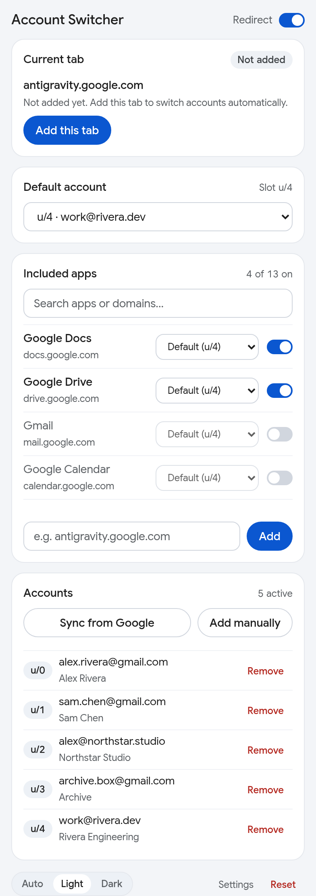
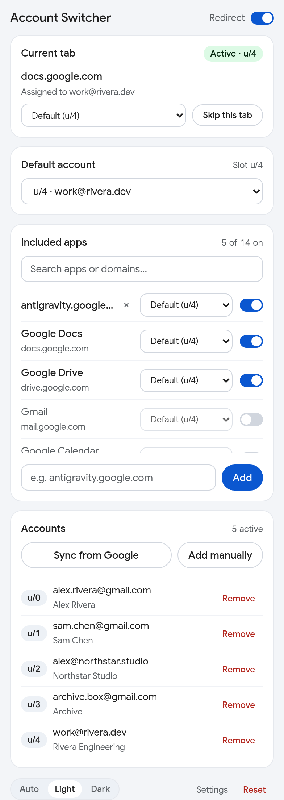
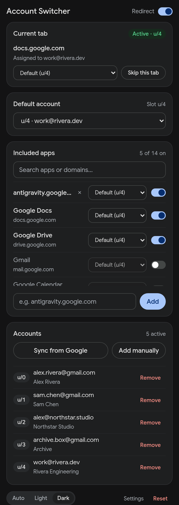
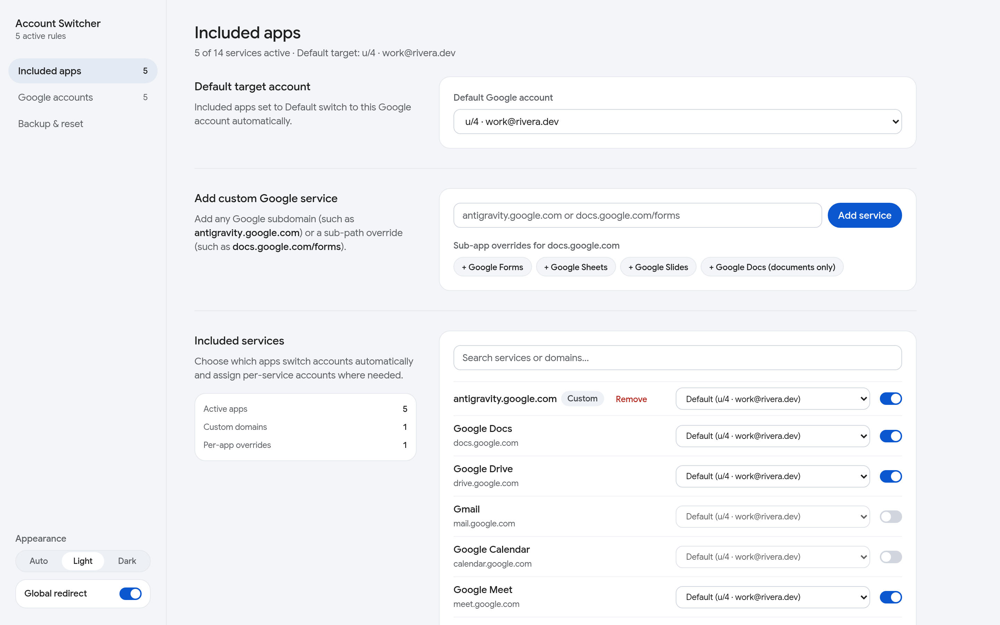
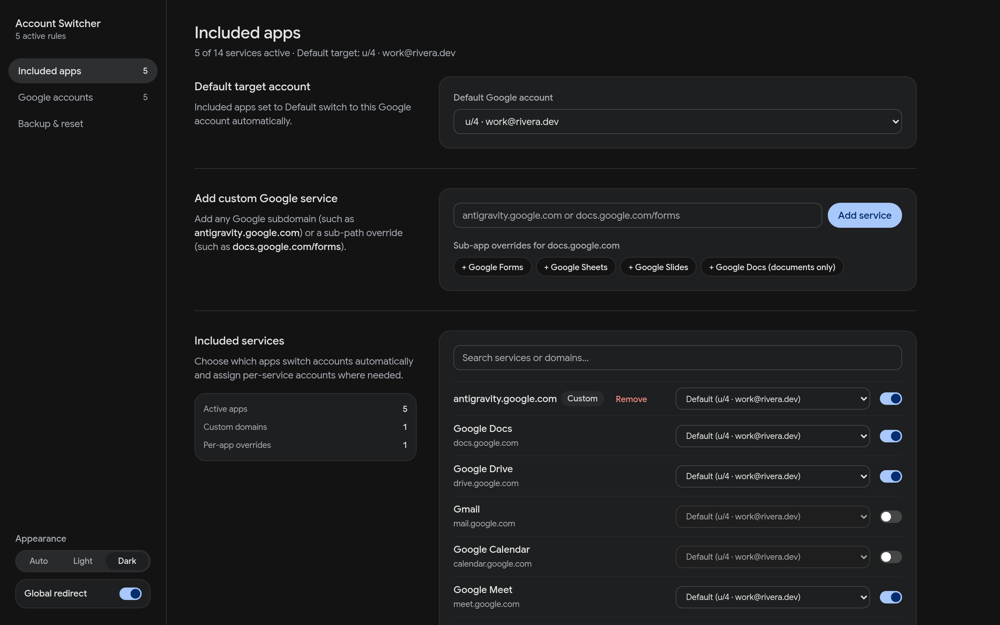

# Account Switcher for Firefox

A clean, lightweight Firefox Manifest V3 extension that automatically switches to your preferred Google account **only on the Google apps and custom domains you choose**.

When you're signed into multiple Google accounts in Firefox (`u/0`, `u/1`, `u/2`, …), Google defaults every shared link, bookmark, and new tab back to `u/0`. **Account Switcher** intercepts navigations before the page loads and routes your included apps straight to the right account — while leaving unlisted apps completely untouched.

---

## Screenshots

<p align="center">
  
  &nbsp;
  
  &nbsp;
  
</p>

<p align="center">
  
  &nbsp;
  
</p>

---

## Features

- **Opt-In Included Apps Only:** Nothing redirects until you turn an app on. Disabled and unlisted Google services stay on standard browser behavior.
- **1-Click "Add this tab" Capture:** Visiting a newer or niche Google product not in the built-in catalog (such as `antigravity.google.com`, `aistudio.google.com`, `idx.google.com`, or `notebooklm.google.com`)? Open the popup and click **Add this tab** to include and route it immediately.
- **Default Account + Per-Service Overrides:** Pick one **Default account** for most apps, then override specific apps (e.g., send Google Classroom to a university account while keeping Google Docs & Drive on your work account).
- **Sub-Path Overrides (`docs.google.com/forms`, `/spreadsheets`, `/presentation`):** Longest-prefix matching lets you route Google Forms or Sheets to a different account than Google Docs.
- **Automatic Google Session Load & Auto-Sync:** Automatically detects your signed-in Firefox Google accounts (`u/0`–`u/N`) on first install, silently refreshes when you sign in or out at `accounts.google.com`, and keeps sibling `u/N` slot indices intact if you hide an account from dropdowns.
- **Respects Manual Switches + "Skip this tab":**
  - Switching accounts manually via Google's top-right avatar menu (`ogs.google.com` / `AccountChooser`) is detected automatically so the extension won't fight you inside that tab.
  - Click **Skip this tab** anytime to pause account enforcement in a single tab while keeping all other tabs active.
- **SPA Redirect-Loop Guard:** Modern single-page Google apps often consume `?authuser=N`, set a session cookie, and `302`-redirect back to clean `/`. Built-in per-tab bounce tracking prevents infinite redirect loops.
- **Light, Dark, & System (`Auto`) Themes:** Clean minimal Google Sans typography with instant zero-flash theme switching.
- **Local JSON Backup & Restore:** Export and import your rules and account mappings from the full Settings page.

---

## How Routing Works

1. **Before navigation (`webRequest.onBeforeRequest`):** Only top-level `GET` `main_frame` navigations matching an **enabled** rule in your Included Apps list are inspected.
2. **Path vs. query rewriting:**
   - Multi-login path URLs (`/u/0/`, `/mail/u/1/`, `/document/u/0/…`) are rewritten in place to `/u/<slot>/` with conflicting `?authuser=` parameters stripped.
   - Shared links (`/document/d/<id>/edit`) and custom Google subdomains without `/u/` paths receive `?authuser=<slot>`.
3. **Safety exclusions:** `accounts.google.com`, OAuth/SAML flows, `Logout`, `AccountChooser`, and direct file downloads (`export=download`) are strictly bypassed so sign-in and file downloads never break.

---

## Permissions & Privacy

Account Switcher runs **100% locally** inside Firefox (`data_collection_permissions: none` — zero analytics, telemetry, or external servers).

| Permission | Why it is needed |
| --- | --- |
| `storage` | Saves your included apps, account slot mappings, and theme preference locally in Firefox. |
| `tabs` | Reads the active tab's domain in the popup to offer 1-click **Add this tab** capture and updates the per-tab `u/N` toolbar badge. |
| `webRequest` & `webRequestBlocking` | Redirects included Google apps to your chosen `u/N` session *before* the wrong account loads, and reads active session slots from `accounts.google.com/ListAccounts`. |
| `https://*.google.com/*` | Covers built-in and custom `*.google.com` subdomains out of the box. |
| `optional_host_permissions` (`https://*/*`) | Requested **only** when you explicitly add and enable a custom non-`*.google.com` Google domain (such as `youtube.com` or `kaggle.com`). |

---

## Installation

### From Source (Temporary Load for Testing)
1. Clone this repository:
   ```bash
   git clone https://github.com/segfawlt/google-account-switcher.git
   cd google-account-switcher
   ```
2. Open Firefox and navigate to `about:debugging#/runtime/this-firefox`.
3. Click **Load Temporary Add-on…** and select `manifest.json`.

### Build Distributable Package (`.zip` / `.xpi`)
Zero bundler or build step is required — the extension ships plain, unminified ES modules:

```bash
npm install
npm test          # Run Vitest unit & redirect state-machine tests
npm run typecheck # Run TypeScript (--checkJs) static verification
npm run lint      # Run Mozilla web-ext Manifest V3 & AMO linter
npm run package   # Output web-ext-artifacts/account_switcher-1.0.0.zip & .xpi
```

---

## License

[MIT](LICENSE) — bundled `Google Sans` font subsets in `src/assets/fonts/` are licensed under the SIL Open Font License 1.1 (`OFL-1.1`).
